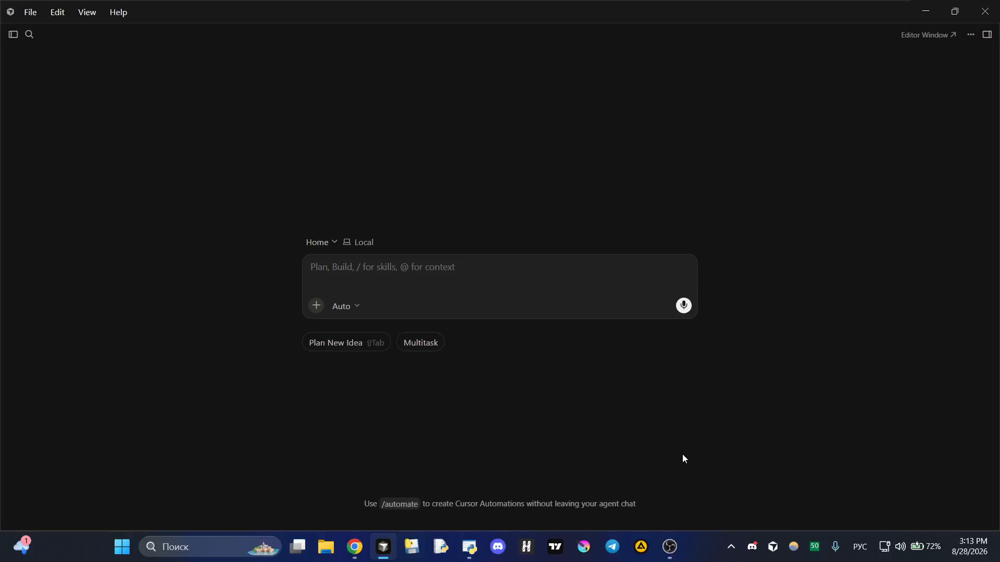
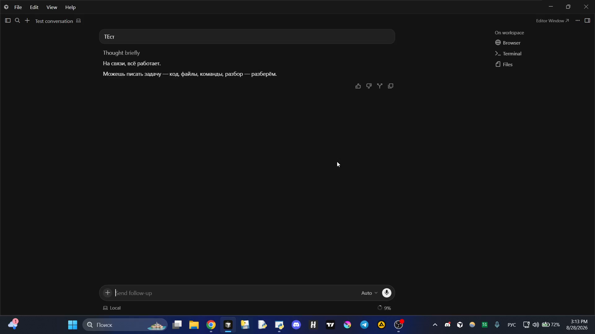
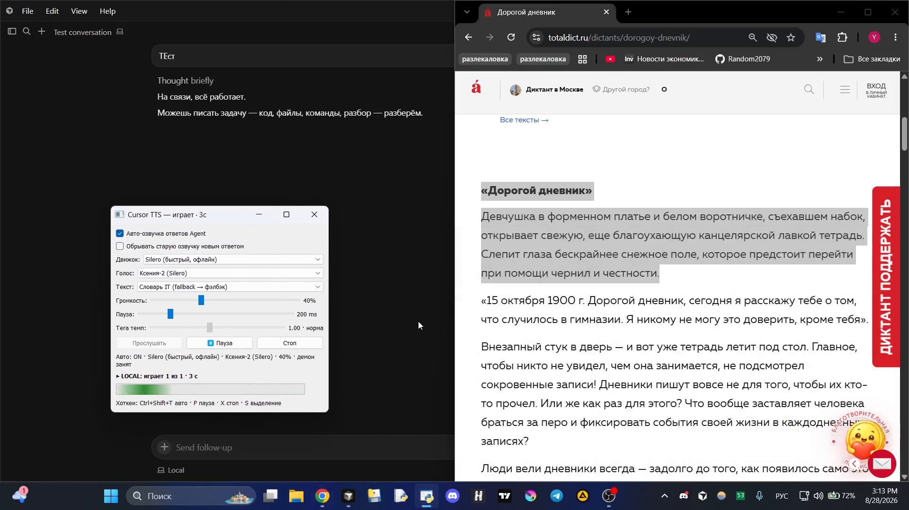

# Cursor TTS

Локальная озвучка ответов **Cursor Agent** на Windows: хук после ответа → фоновый демон → TTS-движок. Панель PyQt, хоткеи AutoHotkey, очередь, пауза на слоге, несколько движков (Tera / Edge / Silero / Qwen).

> Отдельный репозиторий для витрины. Раньше лежало внутри [Portfolio](https://github.com/Random2079/Portfolio) — здесь только TTS, без «мегарепо со всем подряд».

---

## Демо

**Видео (~24 с):** Cursor Agent отвечает → текст озвучивается → панель показывает «играет», можно выделить фрагмент и прослушать отдельно (Silero).

[Скачать / открыть demo_151324.mp4](docs/demo_151324.mp4)

| Agent + ответ | Панель «играет» | Выделение → озвучка |
|:---:|:---:|:---:|
|  |  |  |

Что видно на записи:

- ответ агента уходит в TTS без ручного копирования;
- длинный текст режется на куски, в панели — «N из M кусков» и секунды;
- **Ctrl+Shift+S** — озвучить выделенное;
- движок **Silero (local)** — быстрый офлайн-вариант после прогрева.

---

## Зачем

- Не читать глазами длинные ответы агента — слушать параллельно с кодом.
- Один тёплый процесс (`tts_daemon`, порт 47391): очередь, pause/resume на том же слоге, stop без убийства прогрева Tera/Edge/Silero.
- Подготовка текста под голос: markdown-таблицы, mermaid, стрелки, ru-normalizr.

## Архитектура

```
Cursor hook (afterAgentResponse)
        │
        ▼
  speak_edge.py  ──►  tts_daemon.py  ──►  Tera / Edge / Silero / Qwen / OpenAI
        ▲                      │
   TTS_Panel.py          очередь + warmup
   hotkey_tts.ahk
```

| Компонент | Файл |
|-----------|------|
| Хук | `.cursor/hooks/tts_after_response.py` |
| Клиент | `speak_edge.py` |
| Демон | `tts_daemon.py` |
| Панель | `TTS_Panel.py` |
| Текст | `text_prep.py` |
| Хоткеи | `hotkey_tts.ahk` |

Контракты Stop / warmup / Авто и регрессия: [`docs/TZ.md`](docs/TZ.md).

## Движки

| Engine | Роль | Cold start |
|--------|------|------------|
| **tera** | дефолт, качество | 30–90 с |
| **edge** | онлайн, без ключа | ~1–7 с |
| **local** | Silero офлайн | после warmup быстро |
| **qwen** | GPU, лучшее качество | долго |
| **openai** | облако | ключ + VPN |

Kokoro убран из UI; в коде остались legacy-скрипты для экспериментов.

## Быстрый старт

### 1. Зависимости

```powershell
cd Cursor-TTS   # или путь к клону
pip install -r requirements.txt
```

Нужны: Python 3.11+, PyQt5, pygame, torch (для Silero/Tera/Qwen — по выбранному движку).

### 2. Панель

Двойной клик: `Start_TTS_Panel.vbs` или `Start_TTS_Panel.bat`.

При открытии панель поднимает демон и **прогревает** текущий движок. Статус: загрузка / синтез N из M / играет / очередь.

### 3. Хук Cursor (один раз)

```powershell
powershell -ExecutionPolicy Bypass -File scripts\install_cursor_hook.ps1
```

Скрипт прописывает `run_hook.cmd` в `%USERPROFILE%\.cursor\hooks.json`. Перезапусти Cursor.

Шаблон вручную: [`.cursor/hooks.json.example`](.cursor/hooks.json.example).

### 4. Горячие клавиши

Панель или ярлык поднимают `hotkey_tts.ahk` (AutoHotkey v1.1):

| Комбинация | Действие |
|------------|----------|
| `Ctrl+Shift+T` | авто ON/OFF |
| `Ctrl+Shift+P` | пауза / продолжить (тот же слог) |
| `Ctrl+Shift+X` | стоп: речь + очередь |
| `Ctrl+Shift+S` | озвучить выделение |

## Настройки

`tts_config.json` — движок, голос, громкость, пауза между кусками, темп Tera.

OpenAI: ключ в `.env` (`OPENAI_API_KEY=...`), файл в `.gitignore`.

## Отладка

| Что | Где |
|-----|-----|
| Хук | `%TEMP%\cursor_tts_hook.log` |
| Озвучка | `tts_debug.log`, `tts_last_clean.txt` |
| Демон не подхватил код | закрыть панель / `python speak_edge.py --restart-daemon --warmup` |

## Тесты

```powershell
python -m unittest test_tts_playback.py test_text_prep.py -v
```

## Стек

Python · PyQt5 · AutoHotkey · Cursor Hooks · Silero / Edge TTS / TeraTTS / Qwen-TTS

---

Лицензия не указана — pet-project для личного использования; форкай с пониманием, что модели и ключи — на тебе.
